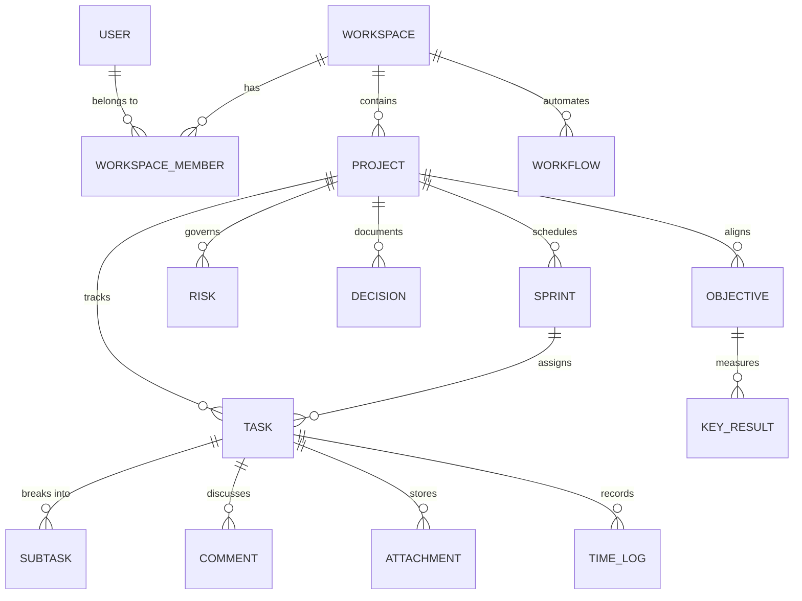

# SprintForge — Domain Models & Entity Relationships

This document details the actual backend domain models, entity relationships, enums, status transitions, and data contracts discovered in the SprintForge codebase.

---

## 1. Domain Overview & Aggregate Roots

SprintForge is structured around 10 primary aggregate roots according to ADR-006 (One Aggregate Root per Service):

1. **Identity & User Aggregate**: `User`, `Role`, `UserPreference`, `RefreshToken`, `PasswordResetToken`, `EmailVerificationToken`
2. **Workspace Aggregate**: `Workspace`, `WorkspaceMember`, `WorkspaceRole`, `WorkspaceInvitation`, `Department`, `Team`, `BusinessCalendar`, `WorkspacePreference`, `WorkspaceBranding`
3. **Project Aggregate**: `Project`, `ProjectMember`, `ProjectRole`, `ProjectCategory`, `ProjectLabel`, `Milestone`, `RoadmapItem`
4. **Sprint & Agile Aggregate**: `Sprint`, `SprintGoal`, `SprintMetrics`, `Epic`, `Story`
5. **Task & Execution Aggregate**: `Task`, `Subtask`, `Checklist`, `TaskHistory`, `TaskAttachment`, `TaskComment`, `TaskWatcher`, `TaskRelationship`, `TaskVersion`, `CustomField`, `CustomFieldValue`
6. **Governance Aggregate**: `Risk`, `Decision`, `Approval`, `ChangeRequest`, `Document`, `GovernanceDashboard`
7. **Strategic OKR Aggregate**: `Goal`, `Objective`, `KeyResult`
8. **Visual Workflow Studio Aggregate**: `Workflow`, `WorkflowVersion`, `NodeDefinition`, `WorkflowExecution`, `WorkflowSimulation`, `WorkflowSecret`
9. **AI Platform Aggregate**: `AIProvider`, `AICapability`, `AIExecutionPolicy`, `AIPromptTemplate`, `AISkill`
10. **Platform & Integrations Aggregate**: `ConnectorPackage`, `IntegrationProvider`, `PlatformLicense`, `FeatureFlag`, `EventLog`, `ScheduledJob`, `StoredFile`, `PlatformNotification`

## 2. Permitted Status Values & Workflow Transitions

### 2.1 Task Status (`TaskStatus`)
- `BACKLOG` → `TODO` → `IN_PROGRESS` → `IN_REVIEW` → `DONE` → `ARCHIVED`
- Supported transitions validated via `GET /api/v1/tasks/{taskId}/allowed-transitions` (`AllowedTransitionsResponse`).

### 2.2 Task Priority (`TaskPriority`)
- `LOW`, `MEDIUM`, `HIGH`, `CRITICAL`

### 2.3 Task Type (`TaskType`)
- `TASK`, `BUG`, `FEATURE`, `SPIKE`, `IMPROVEMENT`

### 2.4 Sprint Status (`SprintStatus`)
- `PLANNED` → `ACTIVE` → `COMPLETED` → `CANCELLED`

### 2.5 Project Status (`ProjectStatus`)
- `PLANNING`, `ACTIVE`, `ON_HOLD`, `COMPLETED`, `ARCHIVED`

### 2.6 Risk Severity & Probability
- Severity: `LOW`, `MEDIUM`, `HIGH`, `CRITICAL`
- Probability: `RARE`, `UNLIKELY`, `POSSIBLE`, `LIKELY`, `ALMOST_CERTAIN`

### 2.7 Approval Status
- `PENDING` → `APPROVED` / `REJECTED` / `REVISED`

### 2.8 Workflow Execution Status
- `PENDING` → `RUNNING` → `COMPLETED` / `FAILED` / `CANCELLED`

## 3. Field Constraints & Validation Conventions

- **IDs**: Backend uses `Long` (or `UUID` for tokens/executions). Frontend must handle numeric 64-bit integers cleanly.
- **Audit Fields**: Every `BaseEntity` includes `createdAt`, `updatedAt`, `createdBy`, `updatedBy`, `deletedAt`, `version` (optimistic locking).
- **Soft Delete**: Entities inherit `SoftDeleteEntity` (`deleted = true`, `deletedAt`). Queries automatically filter out deleted records unless accessed through dedicated trash endpoints.
- **Actor Header**: Many workspace/project/task mutations require or default `X-User-Id` / `X-Actor-ID` injected by `UserHeaderFilter`.
